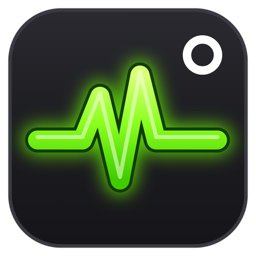
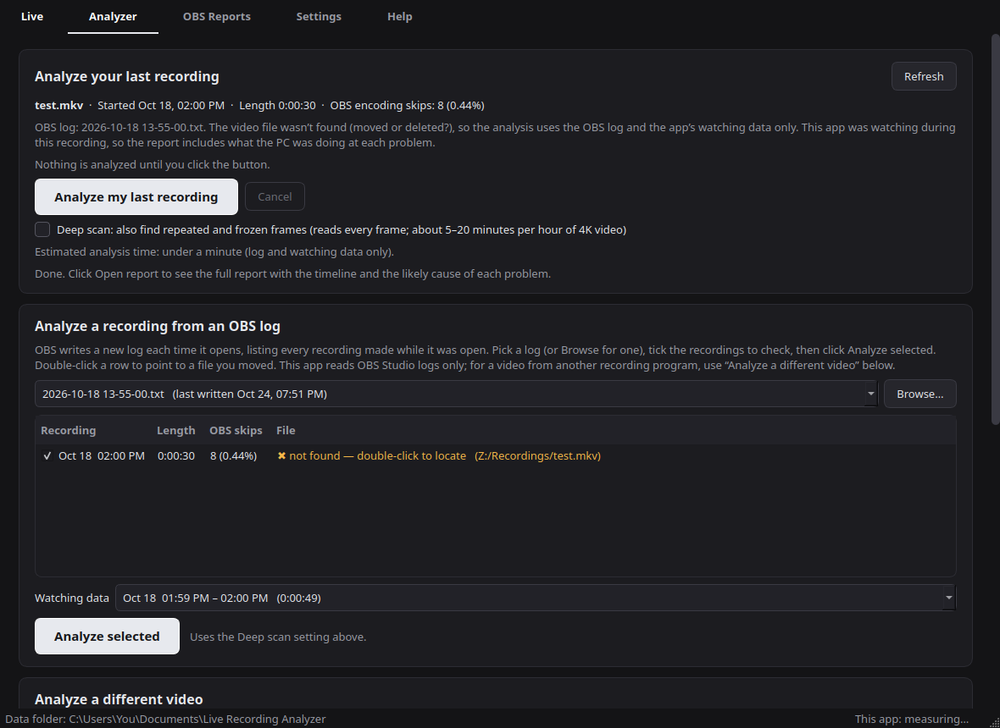
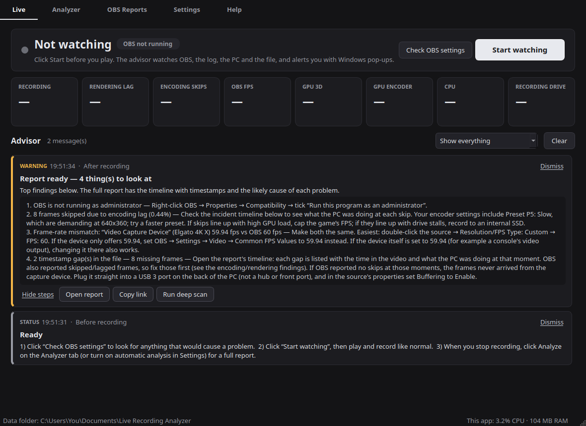
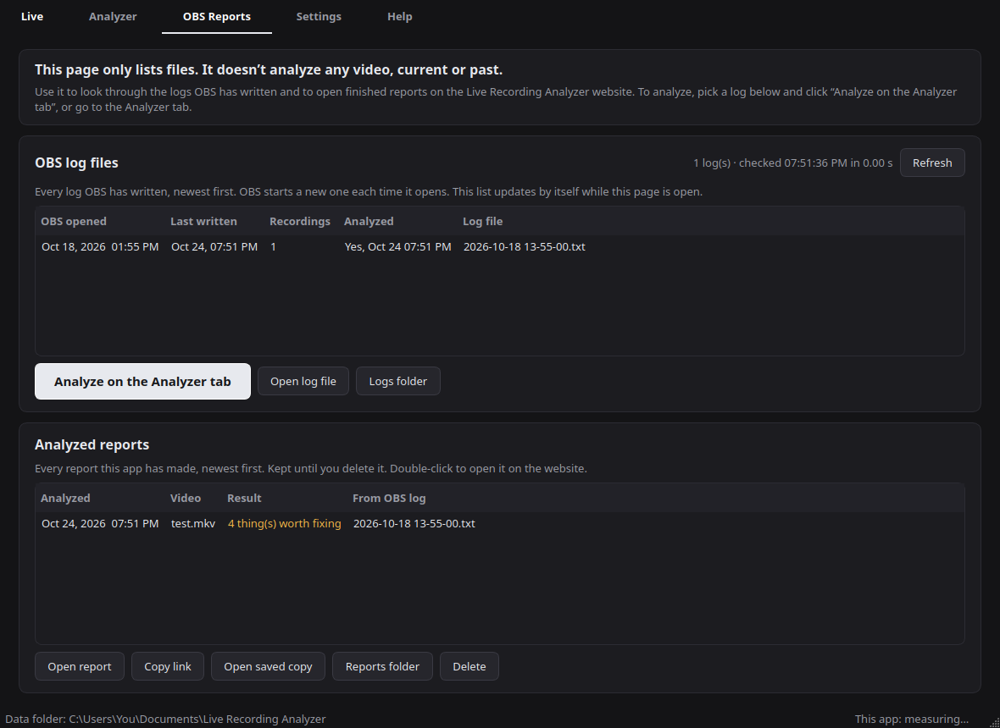
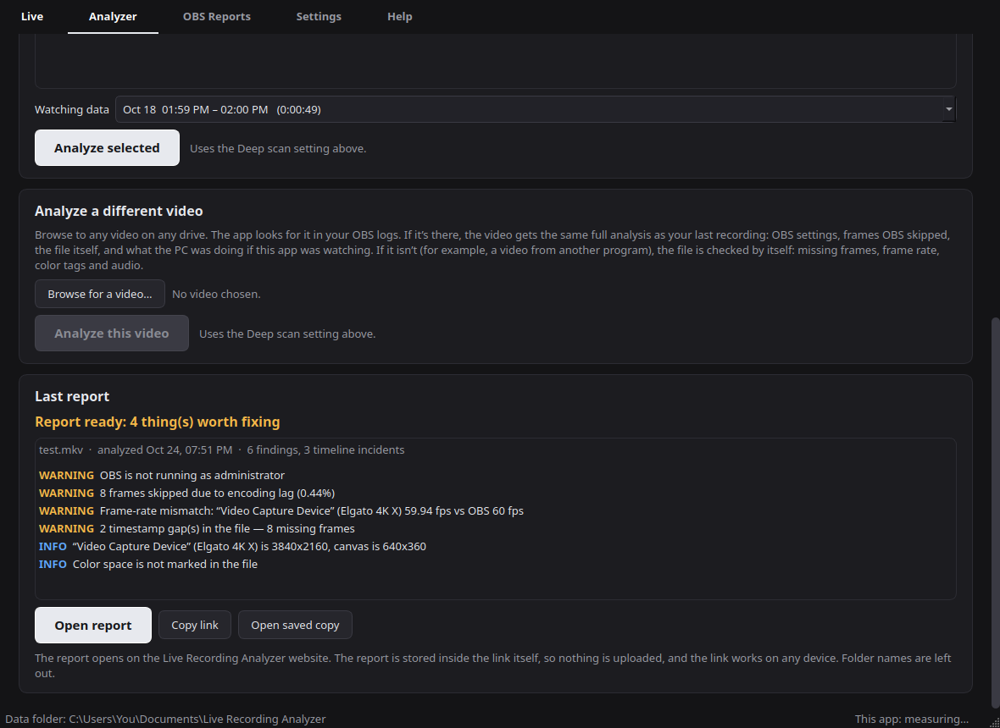
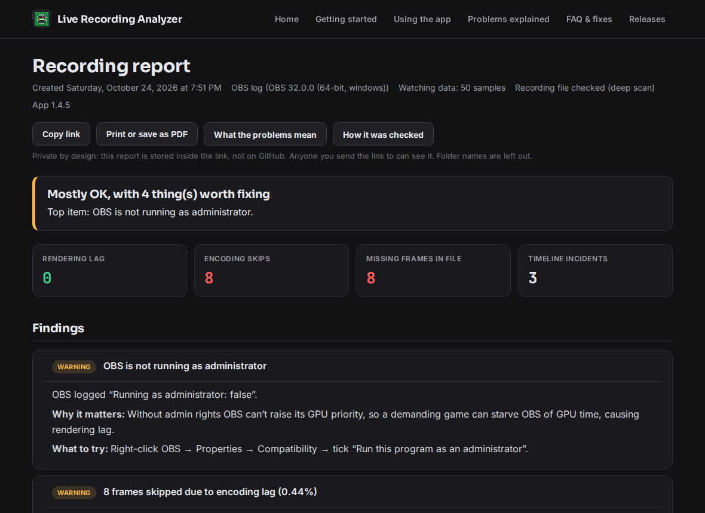
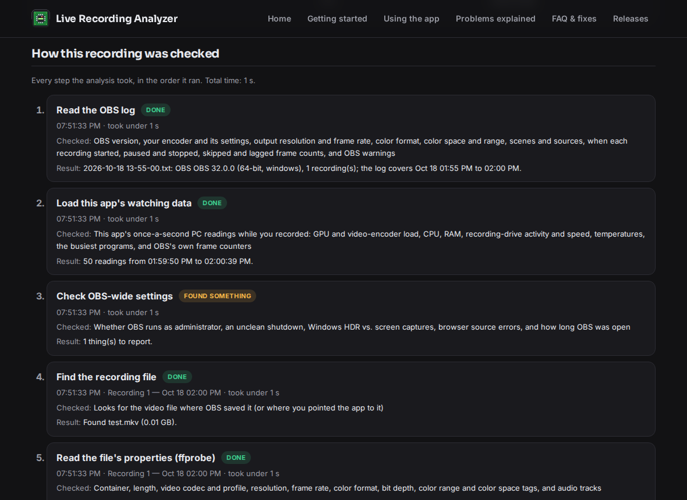

<div align="center">



# Live Recording Analyzer

A Windows desktop app that watches OBS Studio while you record and explains, in plain language, what went wrong, where it came from, and how to fix it.

[](https://github.com/bloodrive65/live-recording-analyzer/actions/workflows/tests.yml)
[](https://github.com/bloodrive65/live-recording-analyzer/actions/workflows/build.yml)
[](https://github.com/bloodrive65/live-recording-analyzer/releases/latest)
[](https://github.com/bloodrive65/live-recording-analyzer/releases)
[](#install)
[](https://bloodrive65.github.io/live-recording-analyzer/)

[](https://github.com/bloodrive65/live-recording-analyzer/releases/latest)

</div>

- Website, guides and FAQ: https://bloodrive65.github.io/live-recording-analyzer/
- Downloads: https://github.com/bloodrive65/live-recording-analyzer/releases/latest



## What it does

- **Live advisor while you record.** A message box in the app shows the live status of OBS, the PC and the recording file. Important problems also show up as Windows pop-ups near the clock, so you don't have to watch the screen while gaming. Each message says what is wrong, where it comes from (game, GPU, encoder, drive, OBS setting, capture device) and what to change.
- **Analyzer tab with four sections:**
  1. **Analyze your last recording.** This runs only when you click it, unless you turn on automatic analysis in Settings.
  2. **Analyze a recording from an OBS log.** Pick any OBS log and choose which recordings to check.
  3. **Analyze a different video.** Browse to any video file. It goes through the same analysis, and the app looks up the matching OBS log on its own.
  4. **Last report.** The result of the most recent analysis, with buttons to open or copy the report.
- **OBS Reports tab (files only).** This tab doesn't analyze anything. It lists every OBS log, kept up to date in the background, and you can send any log to the Analyzer tab. It also lists your saved reports.
- **Reports that show their work.** Each report has a timeline, the likely cause of every problem, the fix, and a numbered "How this recording was checked" list of every step the analysis took.
- **Honest results.** If a check can't finish (a tool fails, the file is cut off, the event log can't be read), the report says "Couldn't finish" or "Only part of the file could be checked" instead of giving an all-clear.
- **Optional deep scan.** Looks inside the video for repeated or frozen frames.
- **Hands off your settings.** The app never changes OBS settings by itself. It tells you what to change and where.

<details>
<summary><b>More screenshots</b></summary>

| Live tab | OBS Reports tab |
|---|---|
|  |  |

| Last report in the app | Report in the browser |
|---|---|
|  |  |



The screenshots use made-up test data, not a real PC.
</details>

## Install

1. Download `Live-Recording-Analyzer-Setup-x.y.z.exe` from [the latest release](https://github.com/bloodrive65/live-recording-analyzer/releases/latest).
2. Run it. The installer isn't code-signed yet, so Windows SmartScreen may warn you. Click **More info → Run anyway**.
3. In OBS, do this once: **Tools → WebSocket Server Settings → tick Enable WebSocket server → OK**. The connection light in the app turns green within a few seconds. The app reads the password by itself.

Updating keeps your reports and settings. Installing over OBS Session Analyzer 1.1 (the old name) also keeps them.

## Privacy

- Everything runs on your PC. Nothing is uploaded.
- **Open report** shows the report on the project website, but the whole report is stored in the link after the `#`. Browsers never send that part to a server. Anyone you send the link to can read the report. Folder names are left out of it.
- Each report is also saved on your PC as a single HTML file that works offline.

<details>
<summary><b>Testing</b></summary>

The tests use made-up OBS logs and small generated videos (see `tests/fixtures.py`), never real user logs. They need `ffmpeg` and `ffprobe` on PATH.

```
pip install -r requirements.txt
python -m unittest discover -s tests -p "test_*.py" -v
```

GitHub Actions runs the tests on every push and pull request, on Windows and Linux. The Linux run checks only the code that doesn't depend on Windows, as groundwork for a Mac version. The Windows installer is built only after the tests pass.
</details>

<details>
<summary><b>Build from source</b></summary>

```
pip install -r requirements.txt pyinstaller
python app.py
```

The `Build` workflow builds the installer and the portable zip on `windows-latest`, with ffmpeg and ffprobe from gyan.dev, on every push to `main`. Pushing a `vX.Y.Z` tag publishes a release. Release steps are in [AGENTS.md](AGENTS.md).
</details>

<details>
<summary><b>Project layout</b></summary>

| Path | What it holds |
|---|---|
| `app.py` | The desktop window (PySide6): tabs, tray pop-ups, settings |
| `analyzer/analyze.py` | Runs an analysis and builds the findings and the step list |
| `analyzer/obs_log.py` | Reads OBS log files |
| `analyzer/obs_config.py` | Reads OBS profiles, scenes and sources |
| `analyzer/obsws.py` | Talks to OBS over its WebSocket |
| `analyzer/live.py` | Live advisor rules and quick file checks |
| `analyzer/monitor.py` | Once-a-second PC readings (GPU, encoder, CPU, drive) |
| `analyzer/video_probe.py` | ffprobe/ffmpeg checks and the deep scan |
| `analyzer/winevents.py` | Windows event log (driver resets, disk errors) |
| `analyzer/report.py`, `weblink.py` | Offline HTML report and the report link |
| `analyzer/steps.py`, `proc.py` | Step list, analysis in its own process |
| `docs/` | Project website (GitHub Pages) and the online report page |
| `packaging/` | Installer script and release notes |
| `tests/` | Automated tests and made-up fixtures |
</details>

## Roadmap

- macOS version (planned). Notes on which parts are Windows-only: [notes/mac-port.md](notes/mac-port.md).

## Not affiliated with OBS

Live Recording Analyzer is an independent project. It isn't made by, affiliated with, or endorsed by the OBS Project. "OBS" and "OBS Studio" are used only to describe compatibility.
